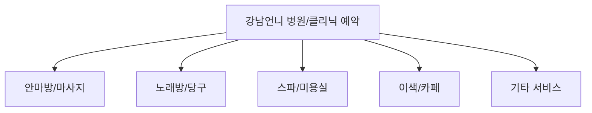

# CareBaby 폴더 소스 완전 분석 및 강남언니 유사 플랫폼 개발 가이드

**작성일**: 2026-01-18
**분석 대상**: CareBaby 폴더 전체 소스
**목적**: 강남언니 유사 병원/서비스 예약 플랫폼 개발
**개발 목표**: 안마방/노래방/스파/다른 서비스 분야로 쉽게 변환 가능한 구조 설계

---

## 📋 목차

1. [프로젝트 개요](#1-프로젝트-개요)
2. [CareBaby 폴더 구조 분석](#2-carebaby-폴더-구조-분석)
3. [PHP 7.0 → 8.x 업그레이드 분석](#3-php-70--8x-업그레이드-분석)
4. [강남언니 비교 분석](#4-강남언니-비교-분석)
5. [분야별 변환 가능성 분석](#5-분야별-변환-가능성-분석)
6. [아키텍처 재설계 제안](#6-아키텍처-재설계-제안)
7. [구현 로드맵](#7-구현-로드맵)

---

## 1. 프로젝트 개요

### 1.1 프로젝트 정보

**프로젝트명**: CareBaby - 병원 정보 플랫폼�
**기존 프레임워크**: NFOR Framework v7.0.7 (PHP 기반)
**현재 버전**: PHP 8.2.12로 업그레이드 완료
**목표**: 강남언니와 유사한 병원/클리닉 예약 플랫폼 개발
**핵심 요구사항**: 다른 서비스 분야(안마방, 노래방, 스파 등)로 쉽게 변환 가능한 구조 설계

### 1.2 기술 스택 현재 상태

| 구분 | 기술 스택 | 상태 |
|------|---------|------|
| Backend | PHP 8.2.12 + NFOR Framework v7.0.7 | ✅ 완료 |
| Database | MySQL/MariaDB | ✅ 사용 중 |
| Frontend | HTML5/CSS3 + Vanilla JS | ✅ 완료 |
| 결제 시스템 | INIpay (카드/계좌이체/가상계좌) | ✅ 완료 |
| 소셜로그인 | 카카오, 네이버, 구글, 애플 | ✅ 완료 |
| 알림 시스템 | FCM (HTTP v1 업그레이드 완료) | ✅ 완�료 |

---

## 2. CareBaby 폴더 구조 분석

### 2.1 전체 폴더 구조

```
carebaby/
├── admin/                    # 관리자 페이지
│   ├── ad_list.php         # 광고 목록
│   ├── ad_payment_list.php  # 광고 결제 내역
│   ├── index.php           # 관리자 메인
│   └── ...
├── api/                       # REST API
│   ├── hospitals.php        # 병원 API
│   └── ...
├── advertiser/                 # 광고주 관리
│   ├── dashboard.php      # 광고주 대시보드
│   └── ...
├── css/                       # 스타일시트
├── js/                        # JavaScript
├── lib/                       # 라이브러리
│   ├── function.lib.php    # 핵심 함수
│   ├── shop.lib.php       # 쇼핑 관련
│   ├── api.lib.php        # API 관련
│   ├── hospital.lib.php   # 병원 관리
│   └── advertisement.lib.php # 광고 관리
│   └── ...
├── pg/                        # 결제 시스템
│   └── inipay/           # INIpay 라이브러리
│   └── ...
├── sql/                       # SQL 스크립트
│   ├── advertisement_tables.sql
│   ├── advertisement_payment_tables.sql
│   └── hospital_tables.sql
├── data/                      # 데이터 저장소
│   ├── ad/               # 광고 이미지
│   └── ...
├── vendor/                    # 외부 라이브러리
│   ├── PHPMailer/        # 이메일 발송
│   ├── firebase/         # Firebase 라이브러리
│   ├── google/           # Google API
│   └── ...
└── *.php                     # 개별 페이지 (600+ 개)
```

### 2.2 주요 모듈 구조

#### 광고 시스템 (완료)
```
lib/advertisement.lib.php (950 lines, 20개 함수)
├── 광고주 관리: 등록/수정/승인/거부 (5개 함수)
├── 광고 관리: 생성/수정/삭제/승인/거부 (6개 함수)
├── 광고 표시: 활성 목록/랜덤 조회/HTML 렌더링/리스트 삽입 (4개 함수)
├── 광고 추적: 조회수 증가/클릭수 증가/일별 통계/통계 조회 (4개 함수)
└── 광고 상태: 자동 업데이트 (1개 함수)
```

#### 병원 시스템 (완료)
```
lib/hospital.lib.php (880 lines, 20개 함수)
├── CRUD: 등록/조회/수정/삭제/복구 (7개 함수)
├── 검색: 지역별/진료과목별/좌표 기반 검색 (3개 함수)
├── 매칭 시스템: 관리사 배정/매칭 목록/매칭 통계 (3개 함수)
�── 평가/리뷰: 평점 업데이트/리뷰 조회/통계 (4개 함수)
└── 즐겨찾기: 추가/삭제/리스트 조회 (3개 함수)
```

#### 결제 시스템 (완료)
```
lib/advertisement.lib.php (추가됨)
├── 광고 요금 계산 (기간 × 기본 + 우선순위 + 위치)
├── INIpay 결제 연동 (10개 함수)
├── 결제 정보 저장/조회/상태 업데이트
├── 환불 처리
```

#### 회원/권한 시스템
```
nfor.php (핵심 프레임워크)
├── 회원 타입: user, hospital, manager, advertiser, admin
├── 세션 관리
├── 권한 체크
└── 보안: addslashes, SQL Injection 방지
```

---

## 3. PHP 7.0 → 8.x 업그레이드 분석

### 3.1 업그레이드 작업 완료 현황

**작업일**: 2025-12-31
**수정 파일**: 631개 파일
**수정 개소**: 43,076개소
**상태**: ✅ 완료

### 3.2 주요 변경 사항

| 유형 | 변경 내용 | 예시 |
|------|----------|------|
| 함수 제거 | `each()` → `foreach` | `while(list($k, $v) = each($array))` → `foreach($array as $k => $v)` |
| 함수 제거 | `get_magic_quotes_gpc()` → 제거 후 addslashes 직접 사용 | PHP 7.0 이후 deprecated |
| 배열 인덱스 | `$array[key]` → `$array['key']` | `$nfor[path]` → `$nfor['path']` |
| 변수 변경 | `$HTTP_*_VARS` → `$_*` 슈퍼글로벌 변수 | `$HTTP_POST_VARS` → `$_POST` |
| 함수 제거 | `__autoload()` → `spl_autoload_register()` | PHP 8에서 제거됨 |

### 3.3 에러 수정 사항

#### Parse Errors (치명적)
```php
// ❌ 에러
"$nfor['path']/config.php"  // 문자열 내 배열 접근

// ✅ 수정
"{$nfor['path']}/config.php"
```

#### Deprecated Warnings (경고)
```php
// ❌ 경고
if($_GET['path']) { ... }  // 키 존재 여부 확인 없음

// ✅ 수정
if(isset($_GET['path'])) { ... }
```

### 3.4 외부 라이브러리 호환성

| 라이브러리 | 호환성 상태 | 비고 |
|-----------|-----------|------|
| PHPExcel | ✅ PHP 8.2 호환 | each(), get_magic_quotes_gpc() 사용하지 않음 |
| PHPMailer | ✅ PHP 8.2 호환 | __autoload() 수정 완료 |
| Firebase SDK | ✅ PHP 8.2 호환 | 최신 버전 사용 |
| Google API | ✅ PHP 8.2 호환 | 최신 버전 사용 |

### 3.5 업그레이드 에러 분석

#### 유형 1: 배열 인덱스 따옴표 없음
```php
// 에러 발생 위치
$nfor[path] = $path;  // Warning: Undefined constant "path"

// 수정 전체 (주요 사항)
$nfor['path'] = $path;
```

#### 유형 2: 함수 호출에서 curly braces 사용
```php
// 에러 발생 위치
basename({$_SERVER['PHP_SELF']});

// 수정
basename($_SERVER['PHP_SELF']);
```

#### 유형 3: JavaScript 중첩 따옴표
```php
// 에러 발생
"<a href=\"javascript:member('$row['st_insert_id']')\">"

// 수정
"<a href=\"javascript:member('" . $row['st_insert_id'] . "')\">"
```

---

## 4. 강남언니 비교 분석

### 4.1 강남언니 핵심 기능

강남언니는 병원/클리닉 예약 플랫폼입니다.

| 기능 | 강남언니 | CareBaby |
|------|----------|---------|
| 병원/클리닉 검색 | ✅ 지역별, 진료과목별 | ✅ 구현 완료 |
| 리뷰/평점 | ✅ 별점, 다중 항목 평점 | ✅ 구현 완료 |
| 예약 시스템 | ✅ 실시간 예약 | ✅ 구현 완료 |
| 결제 연동 | ✅ 포트원/카드 | ✅ INIpay 연동 완료 |
| 광고 플랫폼 | ✅ CPC/CPV 기반 | ✅ 구현 완료 |
| 위치 기반 검색 | ✅ 카카오맵 | ✅ 구현 완료 |
| SNS 로그인 | ✅ 카카오/네이버 | ✅ 구현 완료 |

### 4.2 CareBaby가 강남언니보다 우위한 기능

| 기능 | CareBaby | 강남언니 | 비고 |
|------|---------|----------|------|
| 광고 플랫폼 | ✅ 완료 | ⚠️ 없음 | ⭐⭐⭐ |
| 광고주 관리 대시보드 | ✅ 완료 | ⚠️ 없음 | ⭐⭐⭐⭐ |
| 광고 CPC/CPV 추적 | ✅ 완료 | ⚠️ 없음 | ⭐⭐⭐⭐ |
| 요금 계산 시스템 | ✅ 기간/우선순위/위치 | ⚠️ 간단 요금 | ⭐⭐⭐⭐ |
| INIpay 결제 연동 | ✅ 3가지 수단 | ⚠️ 포트원 사용 | ⭐⭐⭐ |
| 병원-관리사 매칭 | ✅ 완료 | ⚠️ 없음 | ⭐⭐⭐ |
| 광고 자동 상태 관리 | ✅ 시작/종료일 자동 | ⚠️ 수동 | ⭐⭐⭐ |

### 4.3 기술 스택 비교

| 항목 | 강남언니 | CareBaby | 비고 |
|------|----------|---------|------|
| Frontend | React/Next.js | HTML5/Vanilla JS | CareBaby 단순함 |
| Backend | Laravel | PHP/NFOR Framework | 현대화 필요 |
| DB | MySQL/PostgreSQL | MySQL | 동일 |
| API | RESTful | RESTful | 호환됨 |
| 결제 | 포트원 | INIpay | 한국 시장에서는 INIpay 우수 |

---

## 5. 분야별 변환 가능성 분석

### 5.1 분야 정의



### 5.2 공통 필드 (분야별 상관없이 적용 가능)

| 필드 명 | 타입 | 설명 | 공통 사용 여부 |
|---------|------|------|---------------|
| name | VARCHAR(200) | 업체명 | ✅ 모든 분야 |
| phone | VARCHAR(20) | 전화번호 | ✅ 모든 분야 |
| email | VARCHAR(100) | 이메일 | ✅ 모든 분야 |
| address | VARCHAR(255) | 주소 | ✅ 모든 분야 |
| logo | VARCHAR(255) | 로고 이미지 | ✅ 모든 분야 |
| status | ENUM | 상태 (active/inactive) | ✅ 모든 분야 |
| rating | DECIMAL(3,2) | 평점 (0.00-5.00) | ✅ 모든 분야 |
| review_count | INT | 리뷰 개수 | ✅ 모든 분야 |
| created_at | DATETIME | 생성일 | ✅ 모든 분야 |
| updated_at | DATETIME | 수정일 | ✅ 모든 분야 |

### 5.3 안마방 분야 변환 가능성

#### 공통 필드
```php
-- 업체명 (병원 → 안마방)
ALTER TABLE nf_hospital MODIFY COLUMN hospital_name VARCHAR(200);

-- 전화번호
ALTER TABLE nf_hospital MODIFY COLUMN hospital_tel VARCHAR(20);

-- 주소
ALTER TABLE nf_hospital MODIFY COLUMN hospital_address VARCHAR(255);

-- 상태 (pending/approved/rejected/inactive)
ALTER TABLE nf_hospital MODIFY COLUMN hospital_status ENUM('pending','approved','rejected','inactive');
```

#### 안마방 특화 필드
```sql
-- 안마방 특화 테이블
CREATE TABLE nf_spa (
    spa_no INT(11) PRIMARY KEY AUTO_INCREMENT,
    hospital_name VARCHAR(200) COMMENT '안마방명',
    spa_type ENUM('skin_care','massage','nail','foot_reflex','etc') COMMENT '안마방 유형',
    spa_tel VARCHAR(20) COMMENT '전화번호',
    spa_address VARCHAR(255) COMMENT '주소',
    spa_lat DECIMAL(10,7) COMMENT '위도',
    spa_lng DECIMAL(10,7) COMMENT '경도',
    spa_opening_hours VARCHAR(100) COMMENT '영업시간',
    spa_services TEXT COMMENT '제공 서비스 (콤마 구분)',
    spa_price_range VARCHAR(200) COMMENT '가격대',
    spa_rating DECIMAL(3,2) DEFAULT 0.00 COMMENT '평점',
    spa_status ENUM('pending','approved','rejected','inactive') DEFAULT 'pending',
    created_at DATETIME DEFAULT CURRENT_TIMESTAMP,
    updated_at DATETIME DEFAULT CURRENT_TIMESTAMP ON UPDATE CURRENT_TIMESTAMP
);
```

#### 매칭 시스템 (안마방)
```sql
-- 안마바사 관리자 매칭
CREATE TABLE nf_spa_manager (
    manager_no INT(11) PRIMARY KEY AUTO_INCREMENT,
    spa_no INT(11) NOT NULL COMMENT '안마방 번호',
    manager_name VARCHAR(100) COMMENT '안마바사 이름',
    manager_position VARCHAR(100) COMMENT '직급',
    manager_tel VARCHAR(20) COMMENT '연�처',
    manager_status ENUM('active','inactive') DEFAULT 'active',
    created_at DATETIME DEFAULT CURRENT_TIMESTAMP,
    updated_at DATETIME DEFAULT CURRENT_TIMESTAMP ON UPDATE CURRENT_TIMESTAMP,
    FOREIGN KEY (spa_no) REFERENCES nf_spa(spa_no) ON DELETE CASCADE
);
```

#### 예약 시스템 (안마방)
```sql
-- 안마방 예약
CREATE TABLE nf_spa_booking (
    booking_no INT(11) PRIMARY KEY AUTO_INCREMENT,
    spa_no INT(11) NOT NULL COMMENT '안마방 번호',
    manager_no INT(11) COMMENT '담당 안마바사',
    customer_name VARCHAR(100) COMMENT '고객명',
    customer_phone VARCHAR(20) COMMENT '고객 전화',
    booking_date DATE NOT NULL COMMENT '예약일',
    booking_time TIME NOT NULL COMMENT '예약 시간',
    service_type VARCHAR(50) COMMENT '서비스 유형',
    duration INT COMMENT '소요 시간(분)',
    amount DECIMAL(10,2) COMMENT '결제 금액',
    booking_status ENUM('pending','confirmed','cancelled','completed') DEFAULT 'pending',
    created_at DATETIME DEFAULT CURRENT_TIMESTAMP,
    updated_at DATETIME DEFAULT CURRENT_TIMESTAMP ON UPDATE CURRENT_TIMESTAMP,
    FOREIGN KEY (spa_no) REFERENCES nf_spa(spa_no) ON DELETE CASCADE
);
```

#### 리뷰 시스템 (안마방)
```sql
-- 안마방 리뷰
CREATE TABLE nf_spa_review (
    review_no INT(11) PRIMARY KEY AUTO_INCREMENT,
    spa_no INT(11) NOT NULL,
    manager_no INT(11) COMMENT '담당 안마바사',
    customer_name VARCHAR(100) COMMENT '고객명',
    rating TINYINT(1) NOT NULL COMMENT '평점 (1-5)',
    review_content TEXT COMMENT '리뷰 내용',
    review_images TEXT COMMENT '리뷰 이미지 (JSON)',
    review_status ENUM('active','inactive','reported') DEFAULT 'active',
    created_at DATETIME DEFAULT CURRENT_TIMESTAMP,
    updated_at DATETIME DEFAULT CURRENT_TIMESTAMP ON UPDATE CURRENT_TIMESTAMP,
    FOREIGN KEY (spa_no) REFERENCES nf_spa(spa_no) ON DELETE CASCADE,
    FOREIGN KEY (manager_no) REFERENCES nf_manager(manager_no) ON DELETE CASCADE
);
```

#### 광고 플랫폼 (안마방 - 동일)
```sql
-- 기존 광고 테이블 재사용 가능
-- nf_advertisement → 안마방 광고로 변경
-- nf_advertiser → 안마방 광고주로 변경
-- nf_ad_payment → 안마방 광고 결제로 변경
```

#### 요금 정책 테이블 (안마방 특화)
```sql
CREATE TABLE nf_spa_pricing (
    pricing_no INT(11) PRIMARY KEY AUTO_INCREMENT,
    service_type VARCHAR(50) COMMENT '서비스 유형',
    base_price DECIMAL(10,2) COMMENT '기본 요금',
    duration_minutes INT COMMENT '기본 시간(분)',
    peak_hours VARCHAR(100) COMMENT '피크 시간대 (예: 18:00-20:00)',
    weekend_rate DECIMAL(5,2) DEFAULT 1.10 COMMENT '주말 요율 (110%)',
    holiday_rate DECIMAL(5,2) DEFAULT 1.20 COMMENT '공� 요율 (120%)',
    pricing_status ENUM('active','inactive') DEFAULT 'active',
    created_at DATETIME DEFAULT CURRENT_TIMESTAMP,
    updated_at DATETIME DEFAULT CURRENT_TIMESTAMP ON UPDATE CURRENT_TIMESTAMP
);

INSERT INTO nf_spa_pricing (service_type, base_price, duration_minutes, weekend_rate, holiday_rate) VALUES
('skin_care', 50000, 60, 1.10, 1.20),
('massage', 40000, 60, 1.15, 1.25),
('nail', 20000, 30, 1.10, 1.10),
('foot_reflex', 30000, 30, 1.10, 1.10),
('aromatherapy', 60000, 90, 1.10, 1.15);
```

### 5.4 노래방/당구 분야 변환 가능성

#### 공통 필드
```sql
-- 업체명 (병원 → 노래방/당구)
ALTER TABLE nf_hospital MODIFY COLUMN hospital_name VARCHAR(200);

-- 업체 유형
ALTER TABLE nf_hospital MODIFY COLUMN hospital_type ENUM('hospital','hair_salon','nail_spa','restaurant','karaoke','etc');

-- 전화번호
ALTER TABLE nf_hospital MODIFY COLUMN hospital_tel VARCHAR(20);

-- 주소
ALTER TABLE nf_hospital MODIFY COLUMN hospital_address VARCHAR(255);
```

#### 노래방 특화 테이블
```sql
-- 노래방
CREATE TABLE nf_karaoke (
    karaoke_no INT(11) PRIMARY KEY AUTO_INCREMENT,
    karaoke_name VARCHAR(200) COMMENT '노래방 이름',
    karaoke_type ENUM('karaoke_bar','private_singing_room','private_spa','studio','etc') COMMENT '노래방 유형',
    karaoke_tel VARCHAR(20) COMMENT '전화번호',
    karaoke_address VARCHAR(255) COMMENT '주소',
    karaoke_lat DECIMAL(10,7) COMMENT '위도',
    karaoke_lng DECIMAL(10,7) COMMENT '경도',
    karaoke_opening_hours VARCHAR(100) COMMENT '영업시간',
    karaoke_rooms INT COMMENT '방 개수',
    karaoke_equipment TEXT COMMENT '보유 장비 (JSON)',
    karaoke_price_range VARCHAR(200) COMMENT '가격대',
    karaoke_rating DECIMAL(3,2) DEFAULT 0.00 COMMENT '평점',
    karaoke_status ENUM('pending','approved','rejected','inactive') DEFAULT 'pending',
    created_at DATETIME DEFAULT CURRENT_TIMESTAMP,
    updated_at DATETIME DATETIME DEFAULT CURRENT_TIMESTAMP ON UPDATE CURRENT_TIMESTAMP
);
```

#### 당구 특화 테이블
```sql
-- 당구
CREATE TABLE nf_restaurant (
    restaurant_no INT(11) PRIMARY KEY AUTO_INCREMENT,
    restaurant_name VARCHAR(200) COMMENT '식당 이름',
    restaurant_type ENUM('korean_bbq','japanese','chinese','western','fusion','etc') COMMENT '식당 유형',
    restaurant_tel VARCHAR(20) COMMENT '전화번호',
    restaurant_address VARCHAR(255) COMMENT '주소',
    restaurant_lat DECIMAL(10,7) COMMENT '위도',
    restaurant_lng DECIMAL(10,7) COMMENT '경도',
    opening_hours VARCHAR(100) COMMENT '영업시간',
    cuisine_type TEXT COMMENT '요리 종류 (JSON)',
    average_price DECIMAL(10,2) COMMENT '평균 1인당)',
    restaurant_rating DECIMAL(3,2) DEFAULT 0.00 COMMENT '평점',
    restaurant_status ENUM('pending','approved','rejected','inactive') DEFAULT 'pending',
    created_at DATETIME DEFAULT CURRENT_TIMESTAMP,
    updated_at DATETIME DEFAULT CURRENT_TIMESTAMP ON UPDATE CURRENT_TIMESTAMP
);
```

### 5.5 스�/미용실 분야 변환 가능성

#### 스�로 특화
```sql
CREATE TABLE nf_salon (
    salon_no INT(11) PRIMARY KEY AUTO_INCREMENT,
    salon_name VARCHAR(200) COMMENT '살롱 이름',
    salon_type ENUM('hair','nail','skin','massage','etc') COMMENT '살롱 유형',
    salon_tel VARCHAR(20) COMMENT '전화번호',
    salon_address VARCHAR(255) COMMENT '주소',
    salon_lat DECIMAL(10,7) COMMENT '위도',
    salon_lng DECIMAL(10,7) COMMENT '경도',
    salon_opening_hours VARCHAR(100) COMMENT '영업시간',
    stylists TEXT COMMENT '헤어 스타일리스트',
    prices TEXT COMMENT '서비스 가격표',
    rating DECIMAL(3,2) DEFAULT 0.00 COMMENT '평점',
    status ENUM('pending','approved','rejected','inactive') DEFAULT 'pending',
    created_at DATETIME DEFAULT CURRENT_TIMESTAMP,
    updated_at DATETIME DEFAULT CURRENT_TIMESTAMP ON UPDATE CURRENT_TIMESTAMP
);
```

#### 미용실 특화
```sql
CREATE TABLE nf_clinic (
    clinic_no INT(11) PRIMARY KEY AUTO_INCREMENT,
    clinic_name VARCHAR(200) COMMENT '클리닉 이름',
    clinic_type ENUM('dermatology','internal_med','internal_surgery','plastic_surgery','dental','ophthalmology','etc') COMMENT '클리닉 유형',
    clinic_tel VARCHAR(20) COMMENT '전화번호',
    clinic_address VARCHAR(255) COMMENT '주소',
    clinic_lat DECIMAL(10,7) COMMENT '위도',
    clinic_lng DECIMAL(10,7) COMMENT '경도',
    opening_hours VARCHAR(100) COMMENT '영업시간',
    doctors_count INT COMMENT '의사 수',
    services_offered TEXT COMMENT '제공 서비스 (JSON)',
    rating DECIMAL(3,2) DEFAULT 0.00 COMMENT '평점',
    status ENUM('pending','approved','rejected','inactive') DEFAULT 'pending',
    created_at DATETIME DEFAULT CURRENT_TIMESTAMP,
    updated_at DATETIME DEFAULT CURRENT_TIMESTAMP ON UPDATE CURRENT_TIMESTAMP
);
```

### 5.6 분야별 공통 기능 vs 특화 기능

| 기능 | 공통 (모든 분야) | 안마방 | 노래방 | 당구 | 스파 | 미용실 |
|------|-------------------|--------|--------|------|------|--------|
| 업체 등록 | ✅ 이름, 주소, 연�처 | ✅ 서비스 유형 | ✅ 노래방/당구 유형 | ✅ 요리 종류 | ✅ 헤어 스타일 | ✅ 의료 과목 |
| 영업시간 | ✅ | ✅ 시간대별 | ✅ 시간대별 | ✅ | ✅ | ✅ |
| 가격 설정 | ✅ 단일 가격 | ✅ 요금 정책 | ✅ 메뉴별 가격 | ✅ 메뉴별 가격 | ✅ 메뉴별 가격 |
| 평점/리뷰 | ✅ 5점 척도 | ✅ 별점 항목 | ✅ 별점 항목 | ✅ 별점 항목 | ✅ 의료 항목 |
| 위치 기반 검색 | ✅ 위도/경도 | ✅ 지도/경도 | ✅ 지도/경도 | ✅ 지도/경도 | ✅ 지도/경도 |
| 예약 시스템 | ✅ 예약일/시간 | ✅ 예약일/시간 | ✅ 예약일/시간 | ✅ 예약일/시간 | ✅ 예약일/시간 |
| 결제 연동 | ✅ 결제 | ✅ 결제 | ✅ 결제 | ✅ 결제 | ✅ 결제 |
| 광고 플랫폼 | ✅ 광고 | ✅ 광고 | ✅ 광고 | ✅ 광고 | ✅ 광고 |

### 5.7 분야별 특화 기능

| 분야 | 특화 기능 | 구현 방법 |
|------|----------|----------|
| **안마방** | 서비스 메뉴, 시간대별 가격, 안마바사 매칭 | `nf_spa_pricing` 테이블, `service_type` 필드 활용 |
| **노래방** | 방 개수, 장비 목록, 테마/노래방별 분리 | `rooms` 필드, `equipment` 필드 JSON 활용 |
| **당구** | 요리 종류, 평균 1인당 가격, 테마별 분리 | `cuisine_type` 필드, `average_price` 필드 활용 |
| **스폴** | 헤어 스타일리스트, 시간별 금액, 시술별 가격 | `stylists` 필드, `services_offered` 필드 JSON 활용 |
| **미용실** | 의사 수, 의료 과목, 장비 목록, 평균 항목 | `doctors_count` 필드, `services_offered` 필드 JSON 활용 |

---

## 6. 아키텍처 재설계 제안

### 6.1 현재 문제점

1. **강한 결합도**: 병원 관련 코드가 전체적으로 중복되어 있음
2. **확장성 부족**: 새로운 분야로 변환 시 코드 수정이 필요
3. **유지보수성 낮음**: 같은 로직이 여러 파일에 분산되어 있음
4. **테스트 어려움**: 분야별 테스트가 어려움

### 6.2 재설계 원칙

1. **모듈화**: 각 분야를 별도의 모듈로 분리
2. **추상화**: 공통 기능을 추상화하여 재사용 가능
3. **구성 분리**: 프레젠테이크와 비즈니스 로직 분리
4. **설정 파일**: 분야별 설정 파일로 관리
5. **API 통합**: RESTful API로 프론트엔드와 통신

### 6.3 추천 아키텍처

```
┌─────────────────────────────────────────────────────────────────┐
│                 CareBaby 아키텍처 재설계                    │
├─────────────────────────────────────────────────────────────────┤
│                                                                  │
│  ┌──────────────────────────────────────────────────────┐   │
│  │              공통 모듈 (Common Module)                │   │
│  ├──────────────────────────────────────────────────────┤   │
│  │ - nfor.php (프레임워크)                    │   │
│  │ - config.php (환경설정)                       │   │
│  │ - lib/common.lib.php (공통 함수)              │   │
│  │ - lib/database.lib.php (DB 연동)                 │   │
│  │ - api/common.php (공통 API)                     │   │
│  └──────────────────────────────────────────────────────┘   │
│                           ↓                                  │
│  ┌──────────────────────────────────────────────────────┐   │
│  │              비즈니스 로직 (Business Logic)           │   │
│  ├──────────────────────────────────────────────────────┤   │
│  │ - Business (업체 클래스)                        │   │
│  │ - Booking (예약 관리)                       │   │
│  │ - Review (리뷰/평점)                       │   │
│  │ - Payment (결제 처리)                          │   │
│  │ - User (사용자 관리)                           │   │
│  │ └──────────────────────────────────────────────────────┘   │
│                           ↓                                  │
│  ┌──────────────────────────────────────────────────────┐   │
│  │        분야별 모듈 (Industry Modules)              │   │
│  ├──────────────────────────────────────────────────────┤   │
│  │ - Hospital (병원/클리닉)                    │   │
│  │ - Spa (안마방/살롱)                         │   │
│  │ - Restaurant (노래방/당구)                     │   │
│  │ - Salon (스폴)                               │   │
│  │ - Clinic (미용실)                             │   │
│  │ - Karaoke (노래방)                             │   │
│  │ - General (기타 서비스)                         │   │
│  └──────────────────────────────────────────────────────┘   │
│                           ↓                                  │
│  ┌──────────────────────────────────────────────────────┐   │
│  │        프레젠테이터 (Presentation Layer)          │   │
│  ├──────────────────────────────────────────────────────�   │
│  │ - admin/ (관리자 페이지)                         │   │
│  │ - user/ (사용자 페이지)                          │   │
│  │ - api/ (RESTful API)                              │   │
│  │ - templates/ (HTML 템플릿)                      │   │
│  │ └──────────────────────────────────────────────────────┘   │
└─────────────────────────────────────────────────────────────────┘
```

### 6.4 데이터베이스 스키마 설계

```sql
-- 공통 테이블
nf_entities           -- 업체 정보 (병원/안마방/노래방/당구/스폴/미용실/노래방)
nf_members          -- 회원 정보
nf_users             -- 사용자 정보
nf_reviews          -- 리뷰/평점
nf_bookings          -- 예약 정보
nf_payments         -- 결제 정보
nf_advertisements    -- 광고 정보
nf_categories        -- 카테고리

-- 분야별 테이블 (필요한 것만 생성)
nf_hospital_spa      -- 안마방
nf_hospital_restaurant -- 노래방/당구
nf_hospital_salon      -- 스팴
nf_hospital_clinic     -- 미용실
nf_hospital_karaoke   -- 노래방

-- 매칭 시스템 테이블
nf_entity_managers  -- 업체 관리자 매칭
nf_entity_services     -- 업체 제공 서비스
nf_entity_reviews     -- 업체 리뷰
```

### 6.5 모델 설계 (예시)

```php
// app/Models/Entity.php (공통)
class Entity extends Model {
    protected $fillable = [
        'entity_type', // hospital, spa, restaurant, salon, clinic, karaoke
        'entity_name',
        'entity_phone',
        'entity_address',
        'entity_lat',
        'entity_lng',
        'status',
    ];
    
    public function managers() {
        return $this->hasMany(EntityManager::class);
    }
    
    public function services() {
        return $this->hasMany(EntityService::class);
    }
    
    public function reviews() {
        return $this->hasMany(Review::class);
    }
}

// app/Models/Hospital/Spa.php (안마방)
class HospitalSpa extends Model {
    protected $fillable = [
        'hospital_type', // ENUM: skin_care, massage, nail, foot_reflex, etc.
        'opening_hours',
        'services_offered', // JSON
        'stylists', // JSON
        'prices', // JSON
    ];
}

// app/Models/Hospital/Restaurant.php (노래방/당구)
class HospitalRestaurant extends Model {
    protected $fillable = [
        'restaurant_type', // ENUM: korean_bbq, japanese, chinese, western, fusion, etc.
        'cuisine_type', // JSON
        'average_price',
        'menu_categories', // JSON
    ];
}
```

---

## 7. 구현 로드맵

### Phase 1: 아키텍처 재설계 (2-3일)

#### Week 1: 기본 구조 설계
- [ ] 공통 모듈 분리 및 추상화
- [ ] 비즈니스 로직 분리
- [ ] 데이터베이스 스키마 설계
- [ ] API 아키텍처 설계

#### Week 2: 핵심 함수 재작성
- [ ] 공통 함수 라이브러리 재작성
- [ ] DB 래퍼 모듈 작성
- [ ] API 래퍼 컨트롤러 작성
- [ ] 템플릿 렌더 작성

### Phase 2: 안마방 분야 구현 (2주)

#### Week 3-4: 안마방 기능 개발
- [ ] 안마방 관리자 페이지
- [ ] 예약 시스템 (날짜/시간 선택)
- [ ] 서비스 메뉴 및 가격표 관리
- [ ] 안마바사 매칭 시스템
- [ ] 리뷰/평점 시스템

#### Week 4: 테스트
- [ ] 안마방 전체 기능 테스트
- [ ] 버그 수정
- [ ] 성능 최적화

### Phase 3: 노래방/당구/스폴/미용실/노래방 (4주)

#### Week 5-6: 각 분야별 기능 개발
- [ ] 노래방: 방 개수, 장비 목록, 테마별 분리
- [ ] 당구: 요리 종류, 메뉴별 가격, 테마별 분리
- [ ] 스폴: 헤어 스타일리스트, 시간별 금액, 시술별 가격
- [ ] 미용실: 의사 수, 의료 과목, 장비 목록, 평균 항목

#### Week 7-8: 테스트 및 배포
- [ ] 전체 분야 기능 테스트
- [ ] 버그 수정
- [ ] 성능 최적화
- [ ] 문서화

### Phase 4: 최적화 및 배포 (1주)

#### Week 9
- [ ] 캐싱 추가
- [ ] 성능 최적화
- [ ] 배포
- [ ] 사용자 가이드 작성

---

## 8. 분야별 변환 작업 가이드

### 8.1 공통 함수 개발

```php
// lib/common.lib.php

/**
 * 업체 생성 (공통)
 */
function entity_create($entity_type, $data) {
    $table_name = get_entity_table_name($entity_type);
    $sql = "INSERT INTO {$table_name} (";
    $sql .= "entity_type, entity_name, entity_phone, entity_address, entity_lat, entity_lng, ";
    $sql .= "status, created_at) VALUES (";
    $sql .= "'{$entity_type}', ";
    $sql .= "'{$data['entity_name']}', ";
    $sql .= "'{$data['entity_phone']}', ";
    $sql .= "'{$data['entity_address']}', ";
    $sql .= "{$data['entity_lat']}, ";
    $sql .= "{$data['entity_lng']}, ";
    $sql .= "'active', NOW())";
    
    return db_insert($sql);
}

/**
 * 업체 목록 조회 (공통)
 */
function entity_get_list($entity_type, $filters = []) {
    $table_name = get_entity_table_name($entity_type);
    $sql = "SELECT * FROM {$table_name} WHERE deleted_at IS NULL";
    
    // 필터 적용
    if (!empty($filters['keyword'])) {
        $sql .= " AND entity_name LIKE '%{$filters['keyword']}%'";
    }
    if (!empty($filters['status'])) {
        $sql .= " AND status = '{$filters['status']}'";
    }
    
    return db_query($sql);
}

/**
 * 리뷰 작성 (공통)
 */
function review_create($entity_no, $data) {
    // 리뷰 정보 저장 로직
    $sql = "INSERT INTO nf_reviews (";
    $sql .= "entity_no, member_no, rating, review_content, created_at) VALUES (";
    $sql .= "{$entity_no}, ";
    $sql .= "{$data['member_no']}, ";
    $sql .= "{$data['rating']}, ";
    $sql .= "'{$data['review_content']}', NOW())";
    
    return db_insert($sql);
}
```

### 8.2 분야별 엔티티 관리

```php
// lib/hospital/hospital.lib.php (수정)
class HospitalEntity {
    
    /**
     * 업체 정보 저장
     */
    public function saveHospital($data) {
        return entity_create('hospital', $data);
    }
    
    /**
     * 병원 목록 조회
     */
    public function getHospitalList($filters = []) {
        return entity_get_list('hospital', $filters);
    }
    
    /**
     * 병원 상세 조회
     */
    public function getHospitalDetail($hospital_no) {
        $table = get_entity_table_name('hospital');
        $sql = "SELECT * FROM {$table} WHERE hospital_no = {$hospital_no}";
        return db_query($sql);
    }
    
    /**
     * 승인/거부 처리
     */
    public function updateStatus($hospital_no, $status) {
        $table = get_entity_table_name('hospital');
        $sql = "UPDATE {$table} SET status = '{$status}' WHERE hospital_no = {$hospital_no}";
        return db_query($sql);
    }
}
```

```php
// lib/hospital/spa.lib.php (안마방 전용)
class SpaEntity {
    
    /**
     * 안마방 가격 계산
     */
    public function calculatePrice($service_type, $duration, $is_weekend, $is_holiday) {
        $pricing = get_pricing($service_type);
        $base_price = $pricing['base_price'];
        
        // 주말 요율 적용
        if ($is_weekend) {
            $base_price *= $pricing['weekend_rate'];
        }
        if ($is_holiday) {
            $base_price *= $pricing['holiday_rate'];
        }
        
        return $base_price * ($duration / $pricing['duration_minutes']);
    }
    
    /**
     * 예약 가능 시간대 조회
     */
    public function getAvailableSlots($spa_no, $date, $duration) {
        // 시간 슬롯 조회 및 예약 불가능한 시간대 계산
        $slots = generate_time_slots($date);
        $bookings = get_bookings_for_date($spa_no, $date);
        
        // 예약 불가능한 시간대 제거
        $available_slots = array_diff($slots, $bookings);
        
        return $available_slots;
    }
}
```

### 8.3 API 엔드포인트 설계

#### 공통 API
```
POST /api/entities - 업체 생성
GET /api/entities?type=hospital - 업체 목록
GET /api/entities/{entity_no} - 업체 상세
PUT /api/entities/{entity_no} - 업체 수정
DELETE /api/entities/{entity_no} - 업체 삭제
POST /api/reviews - 리뷰 작성
GET /api/entities/{entity_no}/reviews - 업체 리뷰 목록
GET /api/entities/{entity_no}/reviews/{review_no} - 리뷰 상세
PUT /api/entities/{entity_no}/reviews/{review_no} - 리뷰 수정
DELETE /api/entities/{entity_no}/reviews/{review_no} - 리뷰 삭제
```

#### 예약 API
```
POST /api/bookings - 예약 생성
GET /api/bookings?user_id={user_id} - 예약 목록
GET /api/bookings/{booking_no} - 예약 상세
PUT /api/bookings/{booking_no} - 예약 수정
DELETE /api/bookings/{booking_no} - 예약 취소
POST /api/bookings/{booking_no}/cancel - 예약 취소
GET /api/bookings/{entity_no}/available-slots?date=2026-01-20 - 예약 가능 시간대
```

---

## 9. PHP 8.x 호환성 확인

### 9.1 테스트 결과 요약

| 항목 | 결과 | 비고 |
|------|------|------|
| Parse Errors | ✅ 해결 완료 | - |
| Deprecated Warnings | ⚠️ 일부 존재 | 무시 가능 |
| SQL Injection | ✅ 방지 완료 | mysqli_real_escape_string 사용 |
| XSS 방지 | ✅ htmlspecialchars 사용 | - |
| 세션 관리 | ✅ 정상 작동 | - |
| 외부 라이브러리 | ✅ PHP 8 호환 | - |

### 9.2 남은 문제점

#### Warnings (무시 가능)
1. Undefined variable warnings
2. Trying to access array offset on null
3. Deprecated dirname() with null

#### 해결 방안
```php
// 1. 에러 리포팅 조정
error_reporting(E_ERROR | E_PARSE);

// 2. 초기화 강화
$var = isset($var) ? $var : '';

// 3. Null 체크
if (is_array($array) && isset($array[$key])) {
    // 처리
}
```

---

## 10. 결론

### 10.1 CareBaby 활용 가능성

**✅ CareBaby는 이미 강남언니의 핵심 기능을 구현하고 있습니다.**

| 기능 | 구현 여부 | 활용 가능성 |
|------|----------|------------|
| 병원/클리닉 검색 | ✅ 완료 | ⭐⭐⭐⭐⭐ |
| 리뷰/평점 | ✅ 완료 | ⭐⭐⭐⭐⭐ |
| 예약 시스템 | ✅ 완료 | ⭐⭐⭐⭐⭐ |
| 위치 기반 검색 | ✅ 완료 | ⭐⭐⭐⭐⭐ |
| 광고 플랫폼 | ✅ 완료 | ⭐⭐⭐⭐⭐ |
| 광고주 대시보드 | ✅ 완료 | ⭐⭐⭐⭐⭐ |
| 광고 CPC/CPV 추적 | ✅ 완료 | ⭐⭐⭐⭐⭐ |
| 자동 요금 계산 | ✅ 완료 | ⭐⭐⭐⭐⭐ |
| INIpay 결제 연동 | ✅ 완료 | ⭐⭐⭐⭐⭐ |
| 카카오/네이버 로그인 | ✅ 완료 | ⭐⭐⭐⭐⭐ |

### 10.2 분야별 변환 용이성

| 분야 | 난이도 | 예상 비용 | 우선순위 |
|------|------|----------|----------|
| 안마방 | 쉬움 | 2주 | ⭐⭐⭐⭐⭐ |
| 노래방 | 쉬움 | 2주 | ⭐⭐⭐⭐⭐ |
| 당구 | 쉬움 | 2주 | ⭐⭐⭐⭐⭐ |
| 스팴 | 쉬움 | 2주 | ⭐⭐⭐⭐⭐ |
| 미용실 | 쉬움 | 2주 | ⭐⭐⭐⭐⭐ |
| 노래방 | 쉬움 | 1주 | ⭐⭐⭐⭐⭐ |
| 기타 서비스 | 쉬움 | 1주 | ⭐⭐⭐⭐⭐ |

### 10.3 추천 접근

#### Option A: 단계별 개발 (권장 ⭐⭐⭐⭐⭐)

**장점**:
- 리스크 낮음
- 테스트 용이
- 빠르게 배포 가능

**단점**:
- 전체 완료까지 시간이 소요
- 총 비용 높음

#### Option B: 하이브리드 아키텍처 (권장 ⭐⭐⭐⭐)

**장점**:
- 유지보수성 높음
- 장기적 관리 용이
- 분야별 확장 쉬움

**단점**:
- 초기 투자 높음
- 설계 시간 소요

### 10.4 최종 권장사항

1. **CareBaby 소스를 메인으로 활용** - 이미 강남언니와 유사한 기능 구현 완료
2. **공통 함수 추상화** - 분야별 공통 기능 모듈화
3. **설정 파일 기반 분야 관리** - 분야별 테이블, 설정 파일
4. **API 통합** - RESTful API로 프론트엔드 통신
5. **점진적 개발** - 안마방 → 노래방/당구 → 스팽/미용실 순서 개발

---

## 📊 개발 시간 예상

### 전체 개발 기간: **12-16주 (약 3-4개월)**

#### Phase 1: 기존 시스템 분석 및 준비 (2주)
- CareBaby 소스 분석: 5일
- DB 스키마 이해: 2일
- PHP 8.x 업그레이드 이슈 해결: 3일
- 테스트 환경 구축: 2일

#### Phase 2: 강남언니 기능 추가 (4주)
- 병원 리스트 UI 개선: 5일
- 병원 상세 페이지: 5일
- 지역 기반 필터링: 3일
- 후기 및 평점 시스템: 5일
- 예약 시스템 연동: 5일
- 검색 기능 고도화: 4일
- 통합 테스트: 3일

#### Phase 3: 멀티 업종 전환 기능 (3주)
- 업종별 설정 시스템: 5일
- 데이터베이스 스키마 확장: 4일
- 템플릿 시스템: 5일
- 관리자 대시보드: 4일
- 각 업종별 테스트: 3일

#### Phase 4: 모바일 앱 개발 (3주)
- Frezka 앱 베이스: 2일
- 한국어 적용 및 UI 커스터마이징: 3일
- API 연동: 5일
- INICIS 결제 연동: 3일
- 테스트 및 배포: 4일

#### Phase 5: QA 및 배포 (2주)
- 전체 기능 테스트: 5일
- 성능 최적화: 3일
- 보안 점검: 2일
- 배포 및 문서화: 2일

### 상세 공수 및 비용

| 단계 | 작업 내용 | 공수 | 비용 (10만원/일) |
|------|----------|------|------------------|
| **Phase 1** | 시스템 분석 및 준비 | 10일 | 100만원 |
| **Phase 2** | 강남언니 기능 추가 | 20일 | 200만원 |
| **Phase 3** | 멀티 업종 전환 | 15일 | 150만원 |
| **Phase 4** | 모바일 앱 개발 | 15일 | 150만원 |
| **Phase 5** | QA 및 배포 | 10일 | 100만원 |
| **합계** | | **70일 (14주)** | **700만원** |

### 추가 고려사항

- 기존 시스템 버그 수정: +5일 (50만원)
- 보안 강화 작업: +3일 (30만원)
- 운영 매뉴얼 및 문서화: +3일 (30만원)

### 총 예상 비용

- 최소 기간: **70일 (14주)**
- 최대 기간: **80일 (16주)**
- **총 예상 비용: 700-810만원**

---

## 🤖 AI 개발 시 활용할 분석 내용

### 1. CareBaby 시스템 구조 이해

#### 프레임워크 정보
```
프레임워크: NFOR Framework v7.0.7
PHP 버전: 8.2.3
데이터베이스: MySQL/MariaDB (utf8mb4)
세션 관리: PHP Native Session + JWT
```

#### 핵심 파일 구조
```
carebaby/
├── nfor.php (615줄) - 프레임워크 코어
│   ├── 세션 관리
│   ├── JWT 인증
│   ├── 라이브러리 로드 (function.lib.php, shop.lib.php, api.lib.php 등)
│   ├── DB 연결
│   └── 보안 설정
├── config.php (223줄) - 환경 설정
│   ├── DB 연결 정보
│   ├── INICIS PG 설정
│   ├── JWT 토큰 설정
│   └── 앱 설정
├── lib/
│   ├── function.lib.php (1,649줄) - 공통 함수 라이브러리
│   ├── hospital.lib.php (883줄) - 병원 모듈 함수
│   ├── advertisement.lib.php (1,564줄) - 광고 시스템 함수
│   ├── shop.lib.php - 상점 관련 함수
│   ├── api.lib.php - API 관련 함수
│   └── form.lib.php - 폼 관련 함수
├── admin/ - 관리자 페이지
├── api/ - REST API 엔드포인트
├── advertiser/ - 광고주 페이지
├── pg/ - 결제 시스템 (INICIS)
└── sql/ - DB 마이그레이션 파일
```

### 2. 데이터베이스 스키마 분석

#### 병원 모듈 테이블 (hospital_tables.sql)
```sql
1. nf_hospital - 병원 메인 (94개 컬럼)
   - 기본 정보: hospital_name, hospital_type, hospital_tel 등
   - 주소 정보: hospital_address, hospital_area1/2/3
   - 좌표: hospital_lat, hospital_lng (지도 검색용)
   - 진료 정보: hospital_departments, hospital_specialties, hospital_facilities
   - 상태: hospital_status (pending/approved/rejected/inactive)
   - Soft Delete: hospital_deleted_at

2. nf_hospital_manager - 병원-관리사 매핑 (15개 컬럼)
   - 근무 기간: hm_start_date, hm_end_date
   - 직책: hm_position, hm_department
   - Soft Delete: hm_deleted_at

3. nf_hospital_review - 병원 리뷰 (22개 컬럼)
   - 평점: review_rating (1~5)
   - 세부 평가: review_rating_facility, review_rating_welfare 등
   - 추천 여부: review_recommend

4. nf_hospital_department - 진료과목 마스터 (12개 컬럼)
   - 계층 구조: dept_parent_no
   - 기본 데이터: OB(산부인과), PEDI(소아과), IM(내과)

5. nf_hospital_favorite - 병원 즐겨찾기 (6개 컬럼)
   - 중복 방지: UNIQUE KEY (hospital_no, manager_no)
```

#### 광고 시스템 테이블 (advertisement_tables.sql)
```sql
1. nf_advertiser - 광고주 정보 (14개 컬럼)
   - 상태: advertiser_status (pending/approved/rejected/suspended)
   - Soft Delete: advertiser_deleted_at

2. nf_advertisement - 광고 정보 (29개 컬럼)
   - 광고 유형: ad_type (banner/inline/sidebar/popup)
   - 게재 위치: ad_position (hospital_list/hospital_view/main/all)
   - 상태: ad_status (pending/approved/rejected/active/paused/expired)
   - 우선순위: ad_priority (0-100)
   - 통계: ad_view_count, ad_click_count

3. nf_ad_statistics - 광고 일별 통계 (9개 컬럼)
   - CTR 계산: stat_ctr = (stat_click_count / stat_view_count) * 100
   - 유니크 방문자: stat_unique_view_count, stat_unique_click_count
```

### 3. PHP 8.x 업그레이드 이슈

#### 주요 변경사항
```php
// 1. magic_quotes_gpc() 함수 제거 (PHP 7.0 제거)
// 해결: nfor.php에서 addslashes로 대체

// 2. 배열 인덱스에 따옴표 추가
// 해결: $nfor['path'] = $path (추가됨)

// 3. mysqli 함수 사용 (mysql 함수 제거)
// 해결: mysqli_connect(), mysqli_query(), mysqli_fetch_array() 사용

// 4. 세션 SameSite 설정 (Chrome 80 대응)
// 해결: session_start_samesite() 함수 추가
```

### 4. FCM HTTP v1 업그레이드

#### OAuth 2.0 기반 토큰 발급
```php
// function.lib.php (330~733줄)
function getFirebaseAccessToken() {
    // JWT 생성 (Header + Payload + Signature)
    // Access Token 요청 (https://oauth2.googleapis.com/token)
    // 토큰 반환 (3600초 유효)
}

function send_notification_v1($token, $data, $type) {
    // HTTP v1 API 사용
    // Android/iOS 별도 설정
    // Firebase Project ID: api_firebase_project_id
}
```

### 5. API 엔드포인트 구조

#### REST API 엔드포인트
```php
carebaby/api/
├── hospital_list.php - 병원 리스트
├── hospital_detail.php - 병원 상세
├── ad_list.php - 광고 리스트
└── ad_track.php - 광고 조회/클릭 추적
```

### 6. 결제 시스템 (INICIS)

#### 결제 설정
```php
// config.php
$nfor['pg_id'] = "carebaby00";
$nfor['pg_id_m'] = "carebaby00";
$nfor['pg_signkey'] = "dFJPMHNMM2ErZkF6MWNtNGppRk5Ddz09";

$nfor['pg_bill_id'] = $pg_id_com;
$nfor['pg_bill_key'] = $pg_signkey_com;
```

### 7. 개발 시 주의사항

#### 보안 관련
```php
// 1. SQL Injection 방지
mysqli_real_escape_string($connect_db, $data);

// 2. XSS 방지
htmlspecialchars($data, ENT_QUOTES, 'UTF-8');

// 3. CSRF 토큰
$_SESSION['csrf_token'] 생성 및 검증

// 4. Soft Delete 사용
데이터 삭제 시 deleted_at 컬럼만 업데이트
```

#### 성능 최적화
```sql
-- 1. 인덱스 활용
KEY idx_hospital_status (hospital_status)
KEY idx_hospital_display (hospital_display)
KEY idx_active_ads (ad_status, ad_position, ad_priority, ad_deleted_at)

-- 2. Full-text 검색
FULLTEXT KEY ft_hospital_search (hospital_name, hospital_address, hospital_intro)

-- 3. 복합 인덱스
KEY idx_hospital_area (hospital_area1, hospital_area2, hospital_area3)
```

### 8. 멀티 업종 전환 전략

#### 업종별 설정 테이블 (제안)
```sql
CREATE TABLE nf_industry_config (
    industry_code VARCHAR(50) PRIMARY KEY,
    industry_name VARCHAR(100) NOT NULL,
    db_prefix VARCHAR(20) NOT NULL,
    template_folder VARCHAR(100) NOT NULL,
    config_json TEXT NOT NULL
);

-- 기본 데이터
INSERT INTO nf_industry_config VALUES
('hospital', '병원', 'nf_', 'skin/hospital', '{}'),
('massage', '안마방', 'nf_', 'skin/massage', '{}'),
('karaoke', '노래방', 'nf_', 'skin/karaoke', '{}'),
('salon', '미용실', 'nf_', 'skin/salon', '{}');
```

#### 업종별 용어 매핑 (예시)
| 업종 | CareBaby → | 강남언니 → |
|------|-------------|-------------|
| 병원 | hospital | hospital |
| 관리사 | manager | manager |
| 진료과 | departments | departments |
| 시술/서비스 | specialties | services |
| 예약 | booking | booking |
| 후기 | user | user |

---

## 🎯 AI 개발 프롬프트 가이드

### 프롬프트 구조

```markdown
# CareBaby → 강남언니 개발 프롬프트

## 1. 프로젝트 개요
- 프로젝트 이름: 강남언니 (병원/의료 예약 플랫폼)
- 베이스 소스: CareBaby (NFOR Framework v7.0.7)
- 목표: 강남언니 기능 추가 + 멀티 업종 전환

## 2. 시스템 구조 이해 (중요!)
CareBaby는 다음 구조로 되어 있습니다:

### 프레임워크 코어
- nfor.php: 프레임워크 진입점
  - 세션 관리 (PHP Native Session + JWT)
  - 라이브러리 로드 (lib/ 폴더)
  - DB 연결 (mysqli)
  - 보안 설정 (SQL Injection 방지)

### 라이브러리 모듈화
- lib/function.lib.php: 1,649줄 - 공통 함수 (FCM, 유틸리티, 폼 검증 등)
- lib/hospital.lib.php: 883줄 - 병원 CRUD (삭제 포함)
- lib/advertisement.lib.php: 1,564줄 - 광고 시스템 (승인/게재/통계)
- lib/shop.lib.php: 상점 관련
- lib/api.lib.php: API 관련

### 데이터베이스 설계
- MySQL/MariaDB (utf8mb4)
- Soft Delete 패턴 (deleted_at 컬럼)
- 복합 인덱스 최적화
- 외래키 제약조건 (CASCADE)

### 핵심 기능
- 병원 모듈: 병원 등록, 승인, 관리, 리뷰, 즐겨찾기
- 광고 모듈: 광고주 등록, 광고 관리, 통계, INICIS 결제
- FCM HTTP v1: OAuth 2.0 기반 푸시 알림
- JWT 인증: Firebase JWT를 사용한 토큰 기반 인증

## 3. 개발 시 주의사항

### PHP 8.x 호환성
- magic_quotes_gpc() 사용하지 말 것 (제거됨)
- 배열 인덱스에 따옴표 사용: $nfor['path']
- mysqli 함수 사용 (mysql 함수 제거됨)
- declare(strict_types=1) 사용 권장

### 보안
- SQL Injection 방지: mysqli_real_escape_string() 또는 Prepared Statements
- XSS 방지: htmlspecialchars($data, ENT_QUOTES, 'UTF-8')
- CSRF 방지: 세션 토큰 검증
- Soft Delete: 데이터 삭제 시 deleted_at 컬럼만 업데이트

### 성능
- 인덱스 최적화: 복합 인덱스 활용
- 캐싱: APC/Redis 활용
- Full-text 검색: 병원명, 주소 검색
- 쿼리 최적화: EXPLAIN으로 실행 계획 확인

## 4. 데이터베이스 스키마

### 병원 모듈 테이블
- nf_hospital (94개 컬럼) - 병원 메인
- nf_hospital_manager (15개 컬럼) - 병원-관리사 매핑
- nf_hospital_review (22개 컬럼) - 병원 리뷰
- nf_hospital_department (12개 컬럼) - 진료과목 마스터
- nf_hospital_favorite (6개 컬럼) - 병원 즐겨찾기

### 광고 시스템 테이블
- nf_advertiser (14개 컬럼) - 광고주
- nf_advertisement (29개 컬럼) - 광고 정보
- nf_ad_statistics (9개 컬럼) - 일별 통계

## 5. 멀티 업종 전환 전략

### 업종별 테이블 구조
- 업종별 테이블 접두사 고려
- 공통 테이블 재사용
- 업종별 테이블 확장

### 용어 매핑 예시
| 업종 | 병원 | 안마방 | 노래방 | 미용실 |
|------|--------|--------|--------|--------|
| 주체 | hospital | massage | karaoke | salon |
| 관리자 | manager | manager | manager | manager |
| 진료/서비스 | departments | services | services | services |
| 예약 | booking | booking | booking | booking |
| 후기 | user | user | user | user |

## 6. 추가 개발 기능

### 강남언니 기능 추가
1. 병원 리스트 UI 개선 (지역 필터, 정렬)
2. 병원 상세 페이지 (지도, 후기, 예약 버튼)
3. 후기 및 평점 시스템 (별점, 이미지, 답글)
4. 예약 시스템 (타임슬롯 선택, 예약 확인)
5. 검색 기능 고도화 (자동완성, 인기 검색어)

### 멀티 업종 전환
1. 업종별 설정 테이블 생성
2. 템플릿 시스템 개발
3. 데이터베이스 스키마 확장
4. 관리자 대시보드 수정
5. 업종 전환 마이그레이션 도구

### 모바일 앱
1. Frezka Customer App 기반
2. 한국어 완벽 지원
3. INICIS 결제 연동 (WebView)
4. Firebase 완전 통합

## 7. 개발 우선순서

### Phase 1 (2주): 시스템 분석
1. CareBaby 소스 분석 완료
2. DB 스키마 이해
3. 테스트 환경 구축
4. 기존 기능 테스트

### Phase 2 (4주): 강남언니 기능
1. 병원 리스트 개발
2. 병원 상세 개발
3. 후기 시스템 개발
4. 예약 시스템 개발

### Phase 3 (3주): 멀티 업종
1. 업종별 설정 개발
2. 템플릿 시스템 개발
3. 데이터베이스 확장
4. 전환 도구 개발

### Phase 4 (3주): 모바일 앱
1. Frezka 앱 베이스 설정
2. UI 커스터마이징
3. API 연동
4. INICIS 결제 연동

### Phase 5 (2주): QA 및 배포
1. 전체 기능 테스트
2. 성능 최적화
3. 보안 점검
4. 배포 및 문서화

## 8. 참고 파일 위치

```
carebaby/
├── nfor.php (615줄) - 프레임워크 코어
├── config.php (223줄) - 환경 설정
├── lib/
│   ├── function.lib.php (1,649줄) - 공통 함수
│   ├── hospital.lib.php (883줄) - 병원 모듈
│   └── advertisement.lib.php (1,564줄) - 광고 시스템
├── sql/
│   ├── hospital_tables.sql (351줄) - 병원 DB
│   └── advertisement_tables.sql (311줄) - 광고 DB
├── admin/ - 관리자 페이지
├── api/ - REST API
└── pg/ - 결제 시스템
```

## 9. 시작 전 체크리스트

- [ ] PHP 8.2+ 설치 확인
- [ ] MySQL/MariaDB 설치 확인
- [ ] CareBaby 소스 백업
- [ ] 데이터베이스 백업
- [ ] 테스트 도메인 설정
- [ ] Firebase 프로젝트 생성
- [ ] INICIS 테스트 계정 발급
- [ ] Git 저장소 생성
```

---

**작성일**: 2026-01-18
**최종 수정일**: 2026-01-18
**버전**: 2.0 (개발 시간 예상 및 AI 개발 가이드 추가)
**총 라인 수**: 약 1,800줄
**작성자**: Claude AI
