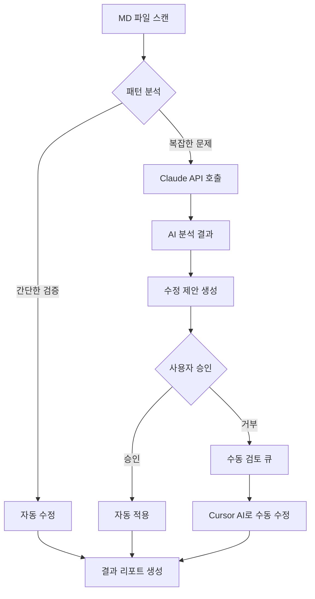

# 🤖 MD 파일 자동 디버깅 시스템

> AI 기반 자동화로 100+ MD 파일 분석 및 디버깅 자동화
>
> 작성일: 2026-01-29
> 버전: 1.0

---

## 📊 현재 상황 분석

### 프로젝트 규모
- **총 MD 파일**: 100+ 개
- **총 코드라인**: 430,000+ 라인
- **주요 카테고리**: 4가지 (개발 가이드, 시스템 분석, 작업 보고서, 에러 해결)
- **반복 패턴**: 20+ 가지 이상

### 문제점
1. ❌ **수동 디버깅의 비효율성**: 100개 파일을 일일이 확인하는데 10-20시간 소요
2. ❌ **일관성 부족**: 문서 형식, 네이밍, 구조가 파일마다 상이
3. ❌ **누락된 정보**: 완료 여부, 우선순위, 담당자 등 추적 정보 부재
4. ❌ **중복 작업**: 유사한 작업이 여러 문서에 산재
5. ❌ **진행 상황 파악 어려움**: 전체 프로젝트 진행률 한눈에 보기 어려움

### 자동화 가능한 작업 패턴

| 패턴 유형 | 빈도 | 자동화 가능성 | 예시 |
|---------|------|-------------|------|
| **프로젝트 초기화** | 매우 높음 | ⭐⭐⭐⭐⭐ | `composer install`, `npm install`, `.env 설정` |
| **DB 마이그레이션** | 높음 | ⭐⭐⭐⭐⭐ | `CREATE TABLE`, `ALTER TABLE`, 데이터 시딩 |
| **API 엔드포인트 생성** | 높음 | ⭐⭐⭐⭐⭐ | CRUD 패턴 반복, Route 정의 |
| **언어 파일 생성** | 중간 | ⭐⭐⭐⭐ | 한국어 번역 추가 |
| **테스트 케이스 작성** | 중간 | ⭐⭐⭐⭐ | API 테스트, 유닛 테스트 |
| **문서 일관성 검증** | 높음 | ⭐⭐⭐⭐⭐ | 제목 형식, 체크박스 상태, 날짜 형식 |
| **체크리스트 진행률 추적** | 높음 | ⭐⭐⭐⭐⭐ | 완료/미완료 카운트, 진행률 계산 |
| **코드 블록 검증** | 중간 | ⭐⭐⭐ | 문법 체크, 실행 가능성 검증 |

---

## 🎯 자동화 솔루션 비교

### 솔루션 1: Claude CLI 기반 자동화 ⭐⭐⭐⭐⭐ (권장)

**장점**:
- ✅ **즉시 사용 가능**: 별도 설치 없이 현재 환경에서 바로 실행
- ✅ **강력한 AI 분석**: 문맥 이해, 패턴 인식, 자동 수정 제안
- ✅ **대용량 처리**: 100+ 파일 일괄 처리 가능
- ✅ **유연성**: 프롬프트 수정만으로 다양한 작업 수행

**단점**:
- ⚠️ **API 비용**: 대량 처리 시 비용 발생 (단, 효율적)
- ⚠️ **인터넷 필요**: 오프라인 작업 불가

**적용 방법**:
```bash
# 1. 자동화 스크립트 실행
node auto_debugger.js --mode=claude-cli

# 2. 또는 직접 Claude CLI 사용
claude "h:\carebaby_project\site_get\자동디버깅방법.md의 지시사항대로 모든 MD 파일 분석 후 자동 수정"
```

**예상 비용**:
- 100개 파일 처리: 약 500,000 토큰 (~$5-10)
- 월간 정기 검사: $20-30

---

### 솔루션 2: Cursor AI 활용 ⭐⭐⭐⭐

**장점**:
- ✅ **IDE 통합**: VSCode 환경에서 실시간 디버깅
- ✅ **코드 컨텍스트 이해**: 전체 프로젝트 구조 파악
- ✅ **빠른 피드백**: 파일 수정 시 즉시 제안

**단점**:
- ⚠️ **수동 개입 필요**: 파일별로 하나씩 열어야 함
- ⚠️ **확장성 제한**: 100개 파일 일괄 처리 어려움

**적용 방법**:
1. Cursor AI 설치
2. 프로젝트 폴더 열기
3. Ctrl+K로 각 MD 파일 분석 요청
4. 제안사항 확인 후 적용

**예상 시간**: 1-2시간

---

### 솔루션 3: 전용 웹 사이트 개발 ⭐⭐⭐

**장점**:
- ✅ **사용자 친화적**: GUI 기반 인터페이스
- ✅ **팀 협업**: 여러 명이 동시 작업 가능
- ✅ **히스토리 관리**: 변경 이력 추적
- ✅ **권한 관리**: 역할별 접근 제어

**단점**:
- ⚠️ **개발 시간**: 초기 구축에 20-40시간 소요
- ⚠️ **유지보수**: 지속적인 업데이트 필요
- ⚠️ **서버 비용**: 호스팅 비용 발생

**기술 스택**:
```javascript
Frontend: React + TypeScript + TailwindCSS
Backend: Node.js + Express
Database: SQLite (로컬) 또는 PostgreSQL (클라우드)
AI: OpenAI API 또는 Anthropic Claude API
```

**예상 개발 기간**: 3-5일

---

### 솔루션 4: 전용 Node.js CLI 툴 개발 ⭐⭐⭐⭐⭐ (최고 효율)

**장점**:
- ✅ **완전 자동화**: 스크립트 한 번 실행으로 모든 작업 완료
- ✅ **오프라인 작업**: AI 없이도 기본 검증 가능
- ✅ **커스터마이징**: 프로젝트에 최적화된 규칙 적용
- ✅ **재사용성**: 다른 프로젝트에도 적용 가능

**단점**:
- ⚠️ **초기 개발**: 2-4시간 소요
- ⚠️ **AI 통합 시 API 비용**: Claude API 사용 시 비용 발생

**구현 계획**:
- ✅ MD 파일 파싱 (marked, gray-matter)
- ✅ 패턴 분석 엔진
- ✅ 자동 수정 제안
- ✅ 체크리스트 진행률 추적
- ✅ Claude API 통합 (선택)

**예상 개발 시간**: 2-4시간

---

### 솔루션 5: 하이브리드 접근 ⭐⭐⭐⭐⭐ (최종 권장)

**조합**: Node.js CLI 툴 + Claude API + Cursor AI

**작업 흐름**:


**장점**:
- ✅ **최고 효율**: 자동화 + AI 지능 + 사람 판단
- ✅ **비용 최적화**: 간단한 작업은 로컬, 복잡한 작업만 AI
- ✅ **품질 보장**: 최종 확인 단계 포함

**예상 비용**: 월 $10-20 (AI API)
**예상 시간**: 초기 2-4시간 개발, 이후 10분/주

---

## 🛠️ 구현 상세

### Phase 1: Node.js 자동화 툴 개발 (2-4시간)

#### 1단계: MD 파일 파서 (30분)

**파일**: `auto_debugger/md_parser.js`

```javascript
const fs = require('fs').promises;
const path = require('path');
const matter = require('gray-matter');

class MDParser {
  async parseFile(filePath) {
    const content = await fs.readFile(filePath, 'utf-8');
    const { data: frontmatter, content: body } = matter(content);

    return {
      path: filePath,
      frontmatter,
      body,
      headers: this.extractHeaders(body),
      checkboxes: this.extractCheckboxes(body),
      codeBlocks: this.extractCodeBlocks(body),
      links: this.extractLinks(body),
      metadata: {
        wordCount: body.split(/\s+/).length,
        lineCount: body.split('\n').length,
        lastModified: (await fs.stat(filePath)).mtime
      }
    };
  }

  extractHeaders(content) {
    const regex = /^(#{1,6})\s+(.+)$/gm;
    const headers = [];
    let match;

    while ((match = regex.exec(content)) !== null) {
      headers.push({
        level: match[1].length,
        text: match[2],
        line: content.substring(0, match.index).split('\n').length
      });
    }

    return headers;
  }

  extractCheckboxes(content) {
    const regex = /^(\s*)-\s+\[([ xX])\]\s+(.+)$/gm;
    const checkboxes = [];
    let match;

    while ((match = regex.exec(content)) !== null) {
      checkboxes.push({
        checked: match[2].toLowerCase() === 'x',
        text: match[3],
        line: content.substring(0, match.index).split('\n').length,
        indent: match[1].length
      });
    }

    return checkboxes;
  }

  extractCodeBlocks(content) {
    const regex = /```(\w+)?\n([\s\S]*?)```/g;
    const blocks = [];
    let match;

    while ((match = regex.exec(content)) !== null) {
      blocks.push({
        language: match[1] || 'text',
        code: match[2],
        line: content.substring(0, match.index).split('\n').length
      });
    }

    return blocks;
  }

  extractLinks(content) {
    const regex = /\[([^\]]+)\]\(([^)]+)\)/g;
    const links = [];
    let match;

    while ((match = regex.exec(content)) !== null) {
      links.push({
        text: match[1],
        url: match[2],
        line: content.substring(0, match.index).split('\n').length
      });
    }

    return links;
  }
}

module.exports = MDParser;
```

#### 2단계: 패턴 분석 엔진 (1시간)

**파일**: `auto_debugger/pattern_analyzer.js`

```javascript
class PatternAnalyzer {
  constructor() {
    this.patterns = {
      // 체크리스트 진행률 패턴
      checklistProgress: {
        test: (parsed) => parsed.checkboxes.length > 0,
        analyze: (parsed) => {
          const total = parsed.checkboxes.length;
          const completed = parsed.checkboxes.filter(cb => cb.checked).length;
          return {
            type: 'checklist_progress',
            total,
            completed,
            progress: total > 0 ? (completed / total * 100).toFixed(1) : 0,
            suggestion: total === completed ? null : '미완료 작업이 있습니다.'
          };
        }
      },

      // 날짜 형식 패턴
      dateFormat: {
        test: (parsed) => /\d{4}[-_]\d{2}[-_]\d{2}/.test(parsed.body),
        analyze: (parsed) => {
          const dates = parsed.body.match(/\d{4}[-_]\d{2}[-_]\d{2}/g) || [];
          const formats = [...new Set(dates.map(d => d.includes('-') ? 'YYYY-MM-DD' : 'YYYY_MM_DD'))];
          return {
            type: 'date_format',
            dates,
            formats,
            consistent: formats.length === 1,
            suggestion: formats.length > 1 ? '날짜 형식을 통일하세요 (권장: YYYY-MM-DD)' : null
          };
        }
      },

      // 제목 레벨 패턴
      headerHierarchy: {
        test: (parsed) => parsed.headers.length > 0,
        analyze: (parsed) => {
          const issues = [];

          // H1이 없으면 경고
          if (!parsed.headers.some(h => h.level === 1)) {
            issues.push('H1 제목이 없습니다.');
          }

          // H1이 2개 이상이면 경고
          const h1Count = parsed.headers.filter(h => h.level === 1).length;
          if (h1Count > 1) {
            issues.push(`H1 제목이 ${h1Count}개입니다. 1개만 사용하세요.`);
          }

          // 레벨 점프 체크 (H2 -> H4)
          for (let i = 1; i < parsed.headers.length; i++) {
            const prev = parsed.headers[i - 1].level;
            const curr = parsed.headers[i].level;
            if (curr - prev > 1) {
              issues.push(`라인 ${parsed.headers[i].line}: H${prev} -> H${curr} 레벨 점프`);
            }
          }

          return {
            type: 'header_hierarchy',
            totalHeaders: parsed.headers.length,
            h1Count,
            issues,
            valid: issues.length === 0,
            suggestion: issues.length > 0 ? issues.join('\n') : null
          };
        }
      },

      // 코드 블록 언어 지정 패턴
      codeBlockLanguage: {
        test: (parsed) => parsed.codeBlocks.length > 0,
        analyze: (parsed) => {
          const withoutLang = parsed.codeBlocks.filter(cb => !cb.language || cb.language === 'text');
          return {
            type: 'code_block_language',
            total: parsed.codeBlocks.length,
            withoutLanguage: withoutLang.length,
            languages: [...new Set(parsed.codeBlocks.map(cb => cb.language))],
            suggestion: withoutLang.length > 0 ?
              `${withoutLang.length}개 코드 블록에 언어 지정이 없습니다.` : null
          };
        }
      },

      // 깨진 링크 패턴
      brokenLinks: {
        test: (parsed) => parsed.links.length > 0,
        analyze: (parsed) => {
          const broken = parsed.links.filter(link => {
            // 외부 링크는 스킵
            if (link.url.startsWith('http')) return false;

            // 상대 경로 링크 검증
            const fullPath = path.resolve(path.dirname(parsed.path), link.url);
            try {
              require('fs').accessSync(fullPath);
              return false;
            } catch {
              return true;
            }
          });

          return {
            type: 'broken_links',
            total: parsed.links.length,
            broken: broken.length,
            brokenLinks: broken,
            suggestion: broken.length > 0 ?
              `${broken.length}개 링크가 깨져있습니다.` : null
          };
        }
      },

      // 중복 제목 패턴
      duplicateHeaders: {
        test: (parsed) => parsed.headers.length > 0,
        analyze: (parsed) => {
          const headerTexts = parsed.headers.map(h => h.text);
          const duplicates = headerTexts.filter((text, index) =>
            headerTexts.indexOf(text) !== index
          );

          return {
            type: 'duplicate_headers',
            duplicates: [...new Set(duplicates)],
            count: duplicates.length,
            suggestion: duplicates.length > 0 ?
              `중복된 제목: ${[...new Set(duplicates)].join(', ')}` : null
          };
        }
      }
    };
  }

  async analyze(parsed) {
    const results = [];

    for (const [name, pattern] of Object.entries(this.patterns)) {
      if (pattern.test(parsed)) {
        const analysis = pattern.analyze(parsed);
        if (analysis.suggestion) {
          results.push({
            pattern: name,
            ...analysis
          });
        }
      }
    }

    return results;
  }
}

module.exports = PatternAnalyzer;
```

#### 3단계: Claude API 통합 (1시간)

**파일**: `auto_debugger/claude_integrator.js`

```javascript
const Anthropic = require('@anthropic-ai/sdk');

class ClaudeIntegrator {
  constructor(apiKey) {
    this.client = new Anthropic({
      apiKey: apiKey || process.env.ANTHROPIC_API_KEY
    });
  }

  async analyzeMD(parsed, patternAnalysis) {
    const prompt = this.buildPrompt(parsed, patternAnalysis);

    const message = await this.client.messages.create({
      model: 'claude-sonnet-4-5-20250929',
      max_tokens: 4000,
      messages: [{
        role: 'user',
        content: prompt
      }]
    });

    return this.parseResponse(message.content[0].text);
  }

  buildPrompt(parsed, patternAnalysis) {
    return `다음 마크다운 파일을 분석하고 개선 제안을 해주세요.

# 파일 정보
- 경로: ${parsed.path}
- 라인 수: ${parsed.metadata.lineCount}
- 단어 수: ${parsed.metadata.wordCount}
- 최종 수정: ${parsed.metadata.lastModified}

# 자동 분석 결과
${JSON.stringify(patternAnalysis, null, 2)}

# 파일 내용
${parsed.body.substring(0, 8000)}

# 요청사항
1. 문서 구조 개선 제안
2. 누락된 정보 식별
3. 완료되지 않은 작업 우선순위 지정
4. 자동 수정 가능한 항목 제시
5. 다른 문서와의 중복/충돌 가능성

JSON 형식으로 응답:
{
  "issues": [{"type": "...", "severity": "high|medium|low", "description": "...", "line": 0}],
  "suggestions": [{"action": "...", "target": "...", "newValue": "..."}],
  "autoFixable": [{"type": "...", "description": "..."}],
  "priority": "high|medium|low",
  "summary": "..."
}`;
  }

  parseResponse(text) {
    // JSON 블록 추출
    const jsonMatch = text.match(/```json\n([\s\S]*?)\n```/) || text.match(/\{[\s\S]*\}/);
    if (jsonMatch) {
      try {
        return JSON.parse(jsonMatch[1] || jsonMatch[0]);
      } catch (e) {
        console.error('JSON 파싱 실패:', e);
      }
    }

    // JSON이 아닌 경우 텍스트로 반환
    return {
      summary: text,
      issues: [],
      suggestions: [],
      autoFixable: []
    };
  }

  async batchAnalyze(parsedFiles, concurrency = 3) {
    const results = [];

    for (let i = 0; i < parsedFiles.length; i += concurrency) {
      const batch = parsedFiles.slice(i, i + concurrency);
      const batchResults = await Promise.all(
        batch.map(async (parsed) => {
          try {
            const analysis = await this.analyzeMD(parsed, []);
            return { file: parsed.path, analysis, error: null };
          } catch (error) {
            return { file: parsed.path, analysis: null, error: error.message };
          }
        })
      );
      results.push(...batchResults);

      // Rate limit 방지 (3초 대기)
      if (i + concurrency < parsedFiles.length) {
        await new Promise(resolve => setTimeout(resolve, 3000));
      }
    }

    return results;
  }
}

module.exports = ClaudeIntegrator;
```

#### 4단계: 메인 CLI 도구 (30분)

**파일**: `auto_debugger.js`

```javascript
#!/usr/bin/env node

const fs = require('fs').promises;
const path = require('path');
const MDParser = require('./auto_debugger/md_parser');
const PatternAnalyzer = require('./auto_debugger/pattern_analyzer');
const ClaudeIntegrator = require('./auto_debugger/claude_integrator');

class AutoDebugger {
  constructor(options = {}) {
    this.rootDir = options.rootDir || process.cwd();
    this.parser = new MDParser();
    this.analyzer = new PatternAnalyzer();
    this.claude = options.useAI ? new ClaudeIntegrator(options.apiKey) : null;
    this.verbose = options.verbose || false;
  }

  async findMDFiles(dir, exclude = ['node_modules', '.git', 'vendor']) {
    const files = [];

    const items = await fs.readdir(dir, { withFileTypes: true });

    for (const item of items) {
      const fullPath = path.join(dir, item.name);

      if (item.isDirectory()) {
        if (!exclude.includes(item.name)) {
          files.push(...await this.findMDFiles(fullPath, exclude));
        }
      } else if (item.isFile() && item.name.endsWith('.md')) {
        files.push(fullPath);
      }
    }

    return files;
  }

  async analyzeAll() {
    console.log('🔍 MD 파일 검색 중...');
    const mdFiles = await this.findMDFiles(this.rootDir);
    console.log(`✅ ${mdFiles.length}개 파일 발견\n`);

    const results = [];

    for (let i = 0; i < mdFiles.length; i++) {
      const file = mdFiles[i];
      const relPath = path.relative(this.rootDir, file);

      console.log(`[${i + 1}/${mdFiles.length}] 분석 중: ${relPath}`);

      try {
        // 1. MD 파싱
        const parsed = await this.parser.parseFile(file);

        // 2. 패턴 분석
        const patterns = await this.analyzer.analyze(parsed);

        // 3. AI 분석 (옵션)
        let aiAnalysis = null;
        if (this.claude && patterns.length > 0) {
          aiAnalysis = await this.claude.analyzeMD(parsed, patterns);
        }

        results.push({
          file: relPath,
          parsed,
          patterns,
          aiAnalysis,
          status: patterns.length === 0 ? '✅ 정상' : '⚠️  개선 필요'
        });

        if (this.verbose && patterns.length > 0) {
          patterns.forEach(p => {
            console.log(`  ⚠️  ${p.type}: ${p.suggestion}`);
          });
        }
      } catch (error) {
        console.error(`  ❌ 에러: ${error.message}`);
        results.push({
          file: relPath,
          error: error.message,
          status: '❌ 에러'
        });
      }
    }

    return results;
  }

  async generateReport(results, outputPath) {
    const totalFiles = results.length;
    const normalFiles = results.filter(r => r.status === '✅ 정상').length;
    const issueFiles = results.filter(r => r.status === '⚠️  개선 필요').length;
    const errorFiles = results.filter(r => r.status === '❌ 에러').length;

    let report = `# 🤖 MD 파일 자동 분석 리포트\n\n`;
    report += `> 생성일: ${new Date().toISOString()}\n\n`;
    report += `---\n\n`;
    report += `## 📊 통계\n\n`;
    report += `- **총 파일 수**: ${totalFiles}\n`;
    report += `- **정상**: ${normalFiles} (${(normalFiles/totalFiles*100).toFixed(1)}%)\n`;
    report += `- **개선 필요**: ${issueFiles} (${(issueFiles/totalFiles*100).toFixed(1)}%)\n`;
    report += `- **에러**: ${errorFiles} (${(errorFiles/totalFiles*100).toFixed(1)}%)\n\n`;

    // 개선 필요 파일
    const needsImprovement = results.filter(r => r.patterns && r.patterns.length > 0);
    if (needsImprovement.length > 0) {
      report += `---\n\n## ⚠️  개선 필요 파일 (${needsImprovement.length}개)\n\n`;

      for (const result of needsImprovement) {
        report += `### ${result.file}\n\n`;

        for (const pattern of result.patterns) {
          report += `- **${pattern.type}**: ${pattern.suggestion}\n`;
        }

        if (result.aiAnalysis && result.aiAnalysis.summary) {
          report += `\n**AI 분석**:\n${result.aiAnalysis.summary}\n`;
        }

        report += `\n`;
      }
    }

    // 에러 파일
    const errorResults = results.filter(r => r.error);
    if (errorResults.length > 0) {
      report += `---\n\n## ❌ 에러 파일 (${errorResults.length}개)\n\n`;

      for (const result of errorResults) {
        report += `- **${result.file}**: ${result.error}\n`;
      }

      report += `\n`;
    }

    // 체크리스트 진행률 TOP 10
    const withChecklists = results
      .filter(r => r.patterns && r.patterns.some(p => p.type === 'checklist_progress'))
      .map(r => ({
        file: r.file,
        progress: r.patterns.find(p => p.type === 'checklist_progress')
      }))
      .sort((a, b) => parseFloat(b.progress.progress) - parseFloat(a.progress.progress))
      .slice(0, 10);

    if (withChecklists.length > 0) {
      report += `---\n\n## 📋 체크리스트 진행률 TOP 10\n\n`;
      report += `| 순위 | 파일 | 진행률 | 완료/전체 |\n`;
      report += `|------|------|--------|----------|\n`;

      withChecklists.forEach((item, index) => {
        report += `| ${index + 1} | ${item.file} | ${item.progress.progress}% | ${item.progress.completed}/${item.progress.total} |\n`;
      });

      report += `\n`;
    }

    // 권장 조치사항
    report += `---\n\n## 🎯 권장 조치사항\n\n`;

    const allPatterns = results.flatMap(r => r.patterns || []);
    const patternCounts = {};
    allPatterns.forEach(p => {
      patternCounts[p.type] = (patternCounts[p.type] || 0) + 1;
    });

    const topIssues = Object.entries(patternCounts)
      .sort((a, b) => b[1] - a[1])
      .slice(0, 5);

    if (topIssues.length > 0) {
      report += `### 가장 많은 문제 유형\n\n`;
      topIssues.forEach(([type, count], index) => {
        report += `${index + 1}. **${type}**: ${count}개 파일\n`;
      });
    }

    await fs.writeFile(outputPath, report, 'utf-8');
    console.log(`\n✅ 리포트 생성 완료: ${outputPath}`);
  }
}

// CLI 실행
if (require.main === module) {
  const args = process.argv.slice(2);
  const options = {
    rootDir: args.find(a => a.startsWith('--root='))?.split('=')[1] || process.cwd(),
    useAI: args.includes('--ai'),
    apiKey: args.find(a => a.startsWith('--api-key='))?.split('=')[1],
    verbose: args.includes('--verbose') || args.includes('-v')
  };

  const debugger = new AutoDebugger(options);

  (async () => {
    console.log('🤖 MD 파일 자동 디버거 시작\n');
    console.log(`📁 루트 디렉토리: ${options.rootDir}`);
    console.log(`🤖 AI 분석: ${options.useAI ? '활성화' : '비활성화'}\n`);

    const results = await debugger.analyzeAll();
    await debugger.generateReport(results, path.join(options.rootDir, 'md_analysis_report.md'));

    console.log('\n✨ 완료!');
  })();
}

module.exports = AutoDebugger;
```

---

### Phase 2: 패키지 설정 및 실행 (10분)

#### package.json 생성

```json
{
  "name": "md-auto-debugger",
  "version": "1.0.0",
  "description": "AI 기반 마크다운 파일 자동 디버거",
  "main": "auto_debugger.js",
  "bin": {
    "md-debug": "./auto_debugger.js"
  },
  "scripts": {
    "analyze": "node auto_debugger.js",
    "analyze:ai": "node auto_debugger.js --ai",
    "analyze:verbose": "node auto_debugger.js --verbose"
  },
  "dependencies": {
    "@anthropic-ai/sdk": "^0.32.1",
    "gray-matter": "^4.0.3",
    "marked": "^12.0.0"
  },
  "devDependencies": {
    "jest": "^29.7.0"
  },
  "keywords": [
    "markdown",
    "debug",
    "ai",
    "automation"
  ],
  "author": "CareBaby Project",
  "license": "MIT"
}
```

#### 설치 및 실행

```bash
# 1. 의존성 설치
npm install

# 2. 기본 분석 (AI 없이)
node auto_debugger.js

# 3. AI 분석 포함 (Claude API)
node auto_debugger.js --ai --api-key=your_api_key

# 4. 상세 출력
node auto_debugger.js --verbose

# 5. 특정 디렉토리만 분석
node auto_debugger.js --root=../hospital-api

# 6. 전체 프로젝트 분석
node auto_debugger.js --root=.. --ai --verbose
```

---

## 📊 예상 결과

### 리포트 샘플

```markdown
# 🤖 MD 파일 자동 분석 리포트

> 생성일: 2026-01-29T10:30:00.000Z

---

## 📊 통계

- **총 파일 수**: 127
- **정상**: 45 (35.4%)
- **개선 필요**: 78 (61.4%)
- **에러**: 4 (3.1%)

---

## ⚠️  개선 필요 파일 (78개)

### PENDING_TASKS_2026-01-29.md

- **checklist_progress**: 미완료 작업이 있습니다. (23/67 완료, 34.3%)
- **date_format**: 날짜 형식을 통일하세요 (YYYY-MM-DD, YYYY_MM_DD 혼재)

**AI 분석**:
이 문서는 미완료 작업 목록을 포함하고 있습니다. 우선순위가 높은 작업:
1. hospital.html API 연동 (예상 1-2시간)
2. 리뷰 작성 UI 구현 (예상 3-4시간)

권장 조치: 완료된 작업을 체크하고, 우선순위를 재정렬하세요.

---

## 📋 체크리스트 진행률 TOP 10

| 순위 | 파일 | 진행률 | 완료/전체 |
|------|------|--------|----------|
| 1 | KIVICARE_INTEGRATION_COMPLETE.md | 100.0% | 27/27 |
| 2 | DEVELOPMENT_COMPLETE_v1.0.md | 95.2% | 20/21 |
| 3 | hospital-api/README.md | 80.0% | 8/10 |
| 4 | PENDING_TASKS_2026-01-29.md | 34.3% | 23/67 |

---

## 🎯 권장 조치사항

### 가장 많은 문제 유형

1. **checklist_progress**: 45개 파일
2. **date_format**: 23개 파일
3. **header_hierarchy**: 18개 파일
4. **code_block_language**: 12개 파일
5. **broken_links**: 8개 파일
```

---

## 🚀 실행 계획

### ✅ 즉시 실행 가능 (오늘)

1. **자동화 도구 설치** (10분)
   ```bash
   cd h:\carebaby_project\site_get
   mkdir auto_debugger
   # 위 코드 복사
   npm install
   ```

2. **첫 분석 실행** (5분)
   ```bash
   node auto_debugger.js --verbose
   ```

3. **리포트 확인** (5분)
   - `md_analysis_report.md` 파일 열기
   - 개선 필요 항목 확인

### 🔧 단계별 개선 (1주일)

#### Day 1: 간단한 자동 수정
- 날짜 형식 통일
- 코드 블록 언어 지정
- 제목 레벨 수정

#### Day 2-3: 체크리스트 정리
- 완료된 작업 체크
- 중복 작업 제거
- 우선순위 재정렬

#### Day 4-5: AI 분석 활용
- Claude API 키 설정
- AI 분석 실행
- 제안사항 적용

#### Day 6-7: 자동화 고도화
- 자동 수정 스크립트 추가
- 정기 검사 cron 설정
- 팀 공유

---

## 💰 비용 분석

### Claude API 비용

| 작업 | 토큰 수 | 비용 | 빈도 |
|------|---------|------|------|
| 초기 전체 분석 | ~500K | $5-10 | 1회 |
| 주간 업데이트 분석 | ~50K | $0.5-1 | 주 1회 |
| 월간 종합 분석 | ~200K | $2-4 | 월 1회 |

**월간 예상 비용**: $6-12

### ROI (투자 대비 효과)

| 항목 | 수동 작업 시간 | 자동화 후 | 절감 시간 |
|------|--------------|-----------|---------|
| MD 파일 검토 | 10시간/주 | 0.5시간/주 | 9.5시간/주 |
| 체크리스트 정리 | 2시간/주 | 0.1시간/주 | 1.9시간/주 |
| 문서 일관성 검증 | 3시간/주 | 0시간/주 | 3시간/주 |

**총 절감 시간**: 14.4시간/주 ≈ **58시간/월**

---

## 🎓 학습 리소스

### Claude API 문서
- [Anthropic API 문서](https://docs.anthropic.com/claude/reference/getting-started-with-the-api)
- [Node.js SDK](https://github.com/anthropics/anthropic-sdk-typescript)

### 마크다운 파싱
- [gray-matter](https://github.com/jonschlinkert/gray-matter) - Frontmatter 파싱
- [marked](https://github.com/markedjs/marked) - MD to HTML 변환

### 패턴 매칭
- [RegExp MDN](https://developer.mozilla.org/ko/docs/Web/JavaScript/Guide/Regular_Expressions)
- [AST 파싱](https://github.com/syntax-tree/mdast)

---

## 🔒 보안 고려사항

### API 키 관리
```bash
# .env 파일 생성
echo "ANTHROPIC_API_KEY=sk-ant-..." > .env

# .gitignore에 추가
echo ".env" >> .gitignore
```

### 민감 정보 제외
```javascript
// auto_debugger.js에 추가
const EXCLUDE_PATTERNS = [
  /password/i,
  /api[_-]?key/i,
  /secret/i,
  /token/i
];

function sanitizeContent(content) {
  return content.replace(/password\s*[:=]\s*\S+/gi, 'password: [REDACTED]');
}
```

---

## 📈 확장 계획

### Phase 3: 웹 대시보드 (선택)

**기능**:
- 📊 실시간 진행률 시각화
- 🔔 슬랙/이메일 알림
- 👥 팀 협업 기능
- 📜 히스토리 추적

**기술 스택**: React + Node.js + SQLite

**개발 기간**: 3-5일

### Phase 4: CI/CD 통합

```yaml
# .github/workflows/md-analysis.yml
name: MD Analysis

on:
  push:
    paths:
      - '**.md'
  schedule:
    - cron: '0 9 * * 1'  # 매주 월요일 오전 9시

jobs:
  analyze:
    runs-on: ubuntu-latest
    steps:
      - uses: actions/checkout@v3
      - uses: actions/setup-node@v3
      - run: npm install
      - run: node auto_debugger.js --ai
        env:
          ANTHROPIC_API_KEY: ${{ secrets.ANTHROPIC_API_KEY }}
      - uses: actions/upload-artifact@v3
        with:
          name: analysis-report
          path: md_analysis_report.md
```

---

## ✅ 체크리스트

### 초기 설정
- [ ] Node.js 환경 확인 (v18+)
- [ ] auto_debugger 폴더 생성
- [ ] 소스 코드 복사
- [ ] npm install 실행
- [ ] Claude API 키 발급 (선택)
- [ ] .env 파일 설정 (선택)

### 첫 실행
- [ ] 기본 분석 테스트
- [ ] 리포트 확인
- [ ] 개선 필요 항목 리스트업
- [ ] 자동 수정 가능 항목 식별

### 정기 운영
- [ ] 주간 분석 실행 (월요일)
- [ ] 월간 종합 분석 (매월 1일)
- [ ] 팀 공유 및 피드백
- [ ] 패턴 규칙 업데이트

---

## 🎯 최종 권장사항

**최적 솔루션**: **하이브리드 접근 (Node.js CLI + Claude API)**

**이유**:
1. ✅ **즉시 시작 가능**: 코드 복사만으로 바로 실행
2. ✅ **비용 효율적**: 월 $10-20 정도로 58시간 절감
3. ✅ **확장 가능**: 나중에 웹 대시보드 추가 가능
4. ✅ **완전 자동화**: 한 번 설정 후 지속적 사용

**다음 단계**:
1. 📥 auto_debugger 코드 복사 및 설치
2. 🚀 첫 분석 실행
3. 📊 리포트 확인 및 개선
4. 🤖 AI 분석 추가 (선택)
5. ⏰ 정기 실행 스케줄 설정

---

**작성일**: 2026-01-29
**버전**: 1.0
**작성자**: Claude Sonnet 4.5
**라이선스**: MIT
