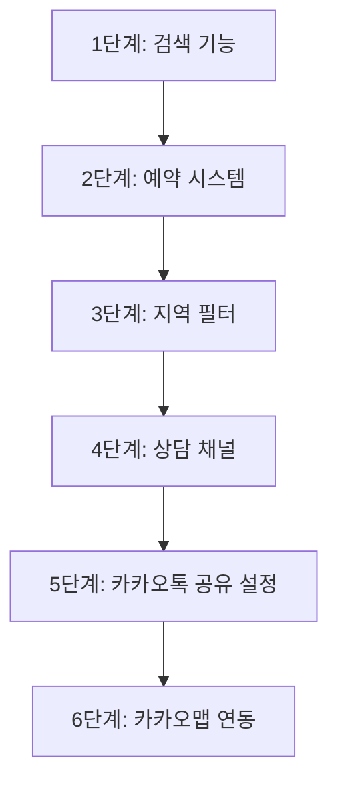

# 📋 미구현 기능 목록

> 프로젝트 내에서 "추후 구현 예정입니다" 메시지가 표시되는 기능들의 전체 목록입니다.
>
> **작성일**: 2026-01-29
> **프로젝트**: hairwang_dev_sns_shop_2026_01_18

---

## 🏥 1. 강남언니 병원 리스팅 페이지 (gangnamunni/)

### 1.1 검색 기능
- **파일**: `gangnamunni/index.php`
- **위치**: Line 448
- **코드**:
  ```javascript
  alert('검색 기능은 추후 구현 예정입니다: ' + this.value);
  ```
- **설명**: 헤더의 검색 입력창에서 Enter 키 입력 시 표시
- **우선순위**: 🔴 높음 (주요 기능)

---

### 1.2 지역 필터 기능
- **파일**: `gangnamunni/index.php`
- **위치**: Line 347-353
- **설명**: 강남, 신촌, 홍대, 명동 등 지역별 필터 버튼 (UI만 구현됨)
- **우선순위**: 🟡 중간 (편의 기능)

---

### 1.3 예약 기능
- **파일**: `gangnamunni/detail.php`
- **위치**: Line 461
- **코드**:
  ```html
  <button class="btn btn-primary" onclick="alert('예약 기능은 추후 구현 예정입니다.')">예약하기</button>
  ```
- **설명**: 병원 상세 페이지 하단의 "예약하기" 버튼
- **우선순위**: 🔴 높음 (핵심 비즈니스 기능)

---

### 1.4 채팅 상담 기능
- **파일**: `gangnamunni/detail.php`
- **위치**: Line 477
- **코드**:
  ```javascript
  alert(label + ' 기능은 추후 구현 예정입니다.');
  ```
- **설명**: 병원 상세 페이지의 "💬 채팅상담" 버튼 클릭 시
- **우선순위**: 🟡 중간 (상담 채널)

---

### 1.5 일반 상담 기능
- **파일**: `gangnamunni/detail.php`
- **위치**: Line 477
- **코드**:
  ```javascript
  alert(label + ' 기능은 추후 구현 예정입니다.');
  ```
- **설명**: 병원 상세 페이지의 "📝 일반상담" 버튼 클릭 시
- **우선순위**: 🟡 중간 (상담 채널)

---

### 1.6 카카오맵 연동
- **파일**: `gangnamunni/detail.php`
- **위치**: Line 440-445
- **설명**: 지도 섹션에 플레이스홀더만 표시 (카카오맵 API 연동 필요)
- **우선순위**: 🟢 낮음 (부가 기능)

---

## 📱 2. SNS/소셜 공유 기능

### 2.1 카카오톡 공유
- **파일**: `theme/rb.basic/skin/member/rb.member/home.skin.php`
- **위치**: Line 1424
- **코드**:
  ```javascript
  alert('카카오톡 공유 기능이 설정되지 않았습니다.\n관리자에게 문의해주세요.');
  ```
- **설명**: 카카오톡 JavaScript Key 미설정 시 표시
- **해결방법**: 관리자 페이지에서 카카오 JavaScript Key 설정 필요
- **우선순위**: 🟡 중간 (소셜 공유)

---

## 💬 3. 게시판 기능

### 3.1 추천/비추천 기능 (비활성 게시판)
- **파일**: `bbs/good.php`
- **위치**: Line 186, 189
- **코드**:
  ```php
  if (!$board['bo_use_good'] && $good == 'good')
      alert('이 게시판은 추천 기능을 사용하지 않습니다.');

  if (!$board['bo_use_nogood'] && $good == 'nogood')
      alert('이 게시판은 비추천 기능을 사용하지 않습니다.');
  ```
- **설명**: 게시판 설정에서 추천/비추천 기능을 비활성화한 경우
- **해결방법**: 관리자 페이지에서 게시판별로 설정 가능
- **우선순위**: 🟢 낮음 (설정 문제)

---

### 3.2 댓글 작성 (로그인 필요)
- **파일**:
  - `theme/rb.basic/skin/board/rb.youtube_bbs/view_comment.skin.php` (Line 462)
  - `theme/rb.basic/skin/board/rb.recruit_bbs/view_comment.skin.php` (Line 462)
- **코드**:
  ```javascript
  alert('로그인이 필요한 기능입니다.');
  ```
- **설명**: 비로그인 상태에서 댓글 작성 시도 시 표시
- **해결방법**: 로그인 후 사용 가능 (미구현 아님, 접근 제어)
- **우선순위**: ✅ 정상 동작 (인증 필요)

---

## 📊 우선순위별 요약

### 🔴 높음 (즉시 구현 필요)
1. **강남언니 검색 기능** - 병원 검색은 필수 기능
2. **강남언니 예약 기능** - 핵심 비즈니스 로직

### 🟡 중간 (단계적 구현)
3. **강남언니 지역 필터** - 사용자 편의성
4. **채팅/일반 상담** - 고객 문의 채널
5. **카카오톡 공유** - 바이럴 마케팅 (설정만 하면 됨)

### 🟢 낮음 (추후 고려)
6. **카카오맵 API 연동** - 지도 표시 (있으면 좋음)
7. **게시판 추천 기능** - 게시판별 설정 문제

---

## 🛠️ 구현 권장 순서



---

## 📝 구현 시 참고사항

### 검색 기능
- 병원명, 주소, 시술 태그로 검색
- AJAX 실시간 검색 또는 페이지 리로드 방식
- MySQL LIKE 또는 FULLTEXT 인덱스 활용

### 예약 시스템
- 병원별 예약 가능 시간 관리
- 사용자 예약 내역 저장 (예약 테이블 생성)
- 병원 관리자 승인 프로세스
- 예약 확인/취소 기능

### 상담 기능
- 채팅: WebSocket 또는 Firebase Realtime Database
- 일반상담: 문의 게시판 형태 또는 1:1 문의 시스템

### 카카오톡 공유
- 현재 코드: `home.skin.php:1424`
- 필요 작업: 관리자 페이지 > 기본환경설정 > SNS 설정 > 카카오 JavaScript Key 입력

---

## 📌 체크리스트

- [ ] 강남언니 검색 기능 구현
- [ ] 강남언니 예약 시스템 구현
- [ ] 강남언니 지역 필터 구현
- [ ] 채팅 상담 구현
- [ ] 일반 상담 구현
- [ ] 카카오톡 공유 설정
- [ ] 카카오맵 API 연동

---

## 💡 추가 발견 사항

### 라이브러리/프레임워크 내부 TODO
프로젝트 내 다음 경로에 개발자 TODO/FIXME 주석이 다수 존재하나, 이는 외부 라이브러리 내부 주석이므로 직접 수정 불가:
- `db/vendor/` - phpMyAdmin, TCPDF, SQL Parser 등
- `db/js/vendor/` - jQuery, jqPlot, OpenLayers 등
- `plugin/editor/` - 스마트에디터2
- `lib/Excel/` - WriteExcel 라이브러리

이들은 라이브러리 업데이트 시 자동 해결됩니다.

---

**마지막 업데이트**: 2026-01-29
**작성자**: Claude Code (Autonomous Development Agent)
